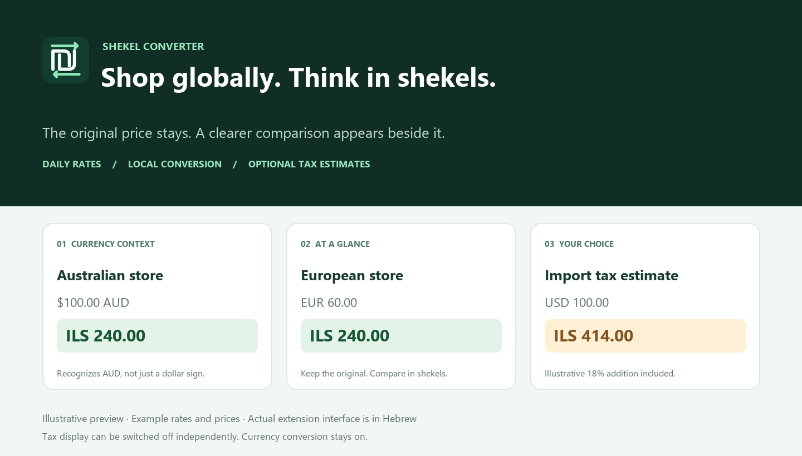

<div align="center">
  
  <h1>Shekel Converter</h1>
  <p><strong>Shop in any currency. Think in shekels.</strong></p>
  <p>A lightweight Chrome extension that adds an estimated ILS price next to the original amount.</p>
  <p>
    <a href="https://github.com/Uriel1010/shekel-converter/actions/workflows/ci.yml"></a>
    <a href="LICENSE"></a>
    
    
  </p>
  <p><a href="https://github.com/Uriel1010/shekel-converter/releases/latest"><strong>Download latest release</strong></a> · <a href="#installation">Install</a> · <a href="#controls">Controls</a> · <a href="PRIVACY.md">Privacy</a> · <a href="CONTRIBUTING.md">Contribute</a></p>
</div>



## Why use it?

Shopping across regional stores makes comparisons awkward, especially when the same `$` symbol can mean USD, AUD, or CAD. Shekel Converter keeps the original price and adds a compact ILS estimate beside it. It works locally in the page and updates as new prices appear.

The extension interface is currently **Hebrew with right-to-left layout**. Repository documentation is in English.

## Features

- **Inline ILS estimates** alongside the original price, without changing checkout currency.
- **Daily exchange rates** with caching, the provider's timestamp, and an offline fallback.
- **Currency context detection** from selected controls, price metadata, structured data, supported country domains, and ASOS regional paths such as `/au/`.
- **Fallback selectors** for ambiguous `$` and `¥` symbols when a page provides no usable context.
- **Dynamic page support** for prices added or changed without a full navigation.
- **Optional import tax estimate** with its own switch: hide tax estimates while keeping conversion on.
- **No account, API key, build step, analytics, or runtime dependencies.**

## Installation

**Current release: [v1.3.0](https://github.com/Uriel1010/shekel-converter/releases/tag/v1.3.0)** · **[Download the extension ZIP](https://github.com/Uriel1010/shekel-converter/releases/download/v1.3.0/shekel-converter-1.3.0.zip)**

This extension is installed locally as an unpacked extension. It is not currently distributed through the Chrome Web Store.

1. Open the [latest release](https://github.com/Uriel1010/shekel-converter/releases/latest), download the extension ZIP, and extract it to a permanent folder. Alternatively, use **Code → Download ZIP** and extract the repository.
2. In Chrome, open `chrome://extensions`.
3. Turn on **Developer mode** in the top corner.
4. Click **Load unpacked**.
5. Select the **folder containing `manifest.json`**. Do not select an individual file or the ZIP archive.
6. Refresh any shopping tabs that were already open.
7. Open Chrome's Extensions menu and pin **הכול בשקלים** for convenient access.

Keep the extracted folder in place: Chrome loads the extension directly from it.

### Updating an existing installation

Replace the files in the same folder, click the reload arrow on the extension card at `chrome://extensions`, and refresh shopping tabs. Preferences remain in Chrome's local extension storage.

## Controls

Click the extension icon to open its popup.

| Control | What it does |
| --- | --- |
| Automatic conversion / **המרה אוטומטית באתרים** | Enables or disables all conversion badges. |
| Import tax estimate / **הצגת מכס / מע״מ משוער** | Shows or hides only the tax estimate. ILS prices remain visible when conversion is enabled. The preference is saved. |
| Dollar fallback | Interprets a bare `$` when automatic detection cannot identify its currency. Defaults to USD. |
| Yen / yuan fallback | Interprets a bare `¥` or `￥`. Defaults to JPY. |
| Refresh rates / **עדכון שערים** | Requests an update and displays the latest available provider timestamp. |

Hover over a conversion to see the source currency and rate timestamp. Once the current extension version is loaded, preference changes apply to open pages without a page refresh.

### Ambiguous currency symbols

Explicit codes and symbols such as `AUD 100`, `US$100`, and `€100` identify the currency directly. For a bare `$`, the extension looks for page currency context. Supported product-level metadata can override page context. If context is missing, the popup's fallback setting is used.

An ASOS URL under `asos.com/au/` can identify an Australian store even though the domain ends in `.com`. Detection is heuristic: verify the source currency in the tooltip when a page is unclear. A selected country does not always establish the billing currency.

### Import tax estimates

When enabled, this version compares each detected price with **US$75**, using the downloaded rates. If the unrounded value is strictly above the threshold, it displays an illustrative **18% addition**, the extra amount in ILS, and the resulting total. Exactly US$75 does not trigger a warning. AUD prices are converted to USD before comparison.

These are fixed calculation settings, **not a complete customs assessment or an automatically maintained statement of tax law**. The estimate applies only to the detected amount. Shipment totals, shipping, insurance, product-specific duties, fees, and tax already collected by a store are not reconciled. Struck-through original prices may also receive estimates; use the actual sale price for your decision. Turn the estimate off using its separate switch whenever it is not useful.

## Exchange rates and privacy

[ExchangeRate-API](https://www.exchangerate-api.com/docs/free) supplies the rates; its open endpoint updates daily. The background worker fetches an ILS-based table and caches it locally. Refreshing does not create a new market quote if the provider has not published new data. Offline use can fall back to cached rates and marks the failed update.

Page text, visited URLs, and detected prices are **not included in the extension's rate request**. The provider still receives ordinary network connection information such as an IP address. See [PRIVACY.md](PRIVACY.md) for the data flow, retention, and permissions.

## Limitations

- Currency detection depends on the signals a page exposes; universal website compatibility is not guaranteed.
- Chrome internal pages, the Chrome Web Store, built-in PDF viewing, images, canvas, and shadow DOM content are not processed.
- Prices split across multiple HTML elements may not be detected.
- Number formats can be ambiguous, especially three-digit groups after a separator.
- Multiple prices in one text node produce a combined conversion badge.
- The badge does not change a store's checkout, payment currency, card fees, or exchange rate.

## Development

Use Node.js 22 or newer. No `npm install` is needed.

```sh
npm test
npm run check
```

Create an installable ZIP using Python 3 (standard library only):

```sh
python scripts/package.py
```

The archive is written to `dist/`, contains only runtime files and the license, and has `manifest.json` at its root. Neither Node nor Python is needed to run the extension in Chrome.

| File | Purpose |
| --- | --- |
| `background.js` | Fetches, validates, and caches rates. |
| `money.js` | Parses prices, resolves currency context, and calculates the estimate. |
| `content.js` / `content.css` | Watches pages and adds conversion badges. |
| `popup.html` / `popup.js` / `popup.css` | Hebrew settings UI and rate status. |
| `icons/` | Chrome icon sizes and editable SVG source. |
| `test.cjs` | Parsing, currency, tax boundary, cache, offline, and preference checks. |

See [CONTRIBUTING.md](CONTRIBUTING.md) for manual verification and [CHANGELOG.md](CHANGELOG.md) for version history.

## Feedback

[Open an issue](https://github.com/Uriel1010/shekel-converter/issues/new/choose) with the public URL, expected currency, extension version, and a redacted screenshot. Remove account details and order information before sharing.

## License and credits

[MIT](LICENSE) · Created by [Uriel1010](https://github.com/Uriel1010).

Exchange rates: [Rates By Exchange Rate API](https://www.exchangerate-api.com). Provider data and services have their own terms; the MIT license applies to the project code and original assets.
